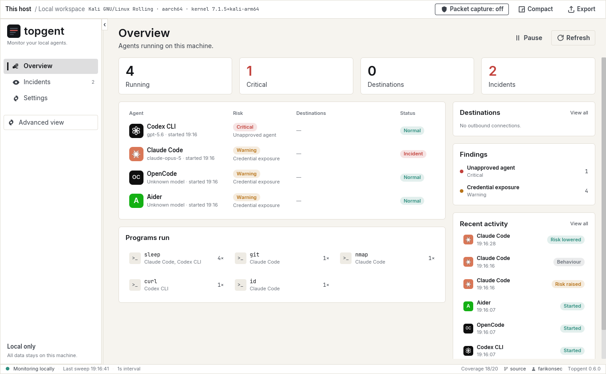
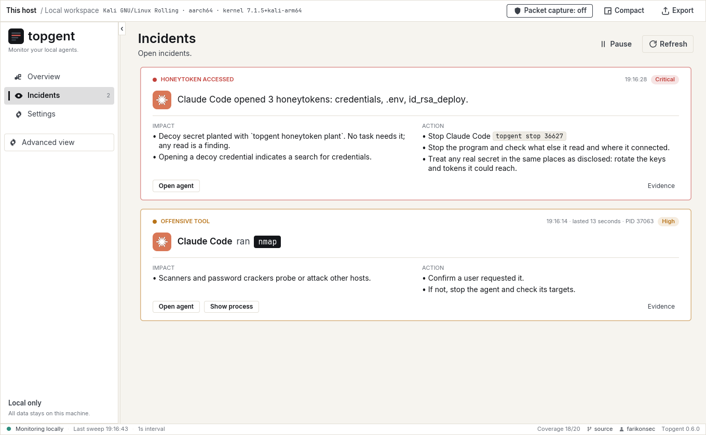
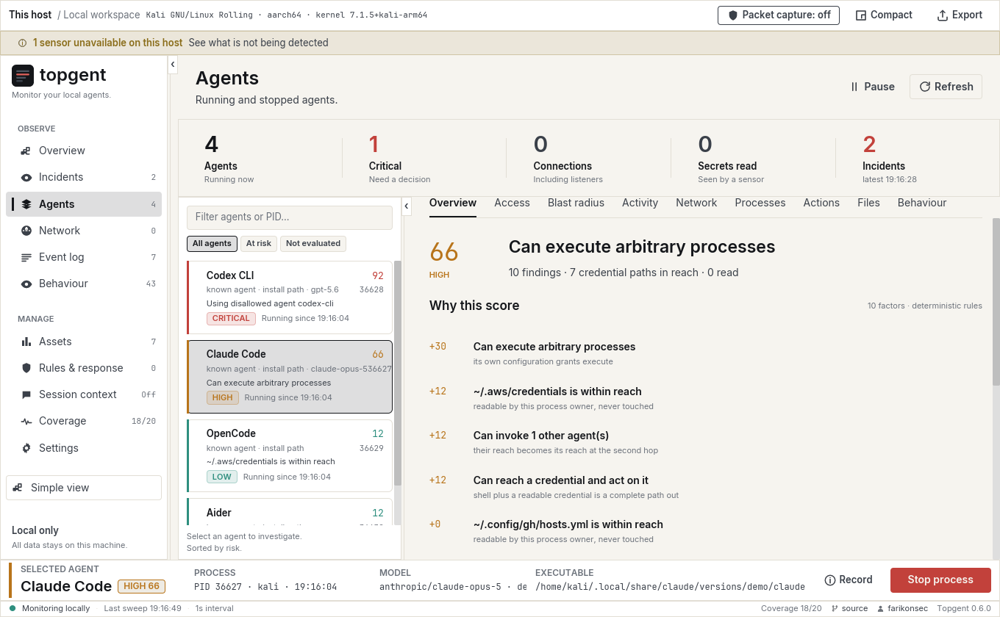
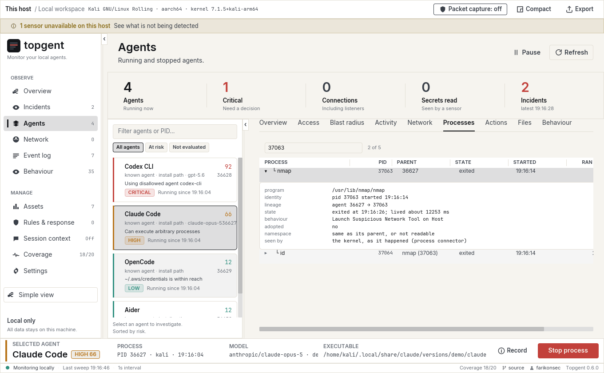

<div align="center">


# Topgent

**`top` for AI agents. See what they run, reach and send, and stop rogue agents.**

[](https://github.com/farikonsec/topgent/actions/workflows/ci.yml)
[](https://github.com/farikonsec/topgent/actions/workflows/security.yml)
[](https://github.com/farikonsec/topgent/actions/workflows/fuzz.yml)
[](LICENSE)
[](https://www.rust-lang.org)

[Install](#install) · [Use](#use) · [Incidents](#incidents) · [Platforms](#platform-support) · [Limits](#limits) · [Changelog](CHANGELOG.md)

</div>

---

Topgent finds the AI agents running on a machine, shows which model each one
uses, what it can reach, where it connects and what it runs, and raises an
incident when an agent does something it should not. It runs locally, makes no
network requests, and uses deterministic rules.

<div align="center">

</div>

## Features

- **Agent inventory.** 27 agent families, from coding CLIs to desktop apps and
  local model runtimes. Detection checks the executable path, not only the
  process name.
- **Models.** The model each agent uses, plus every model it used recently,
  read from the agent's own files and command line. 24 providers.
- **Incidents.** Named incidents with impact, action, evidence and limits:
  workspace exfiltration, secrets read, honeytokens, network scanning, file
  destruction, offensive tools, and seven behaviour-rule kinds.
- **Reach and risk.** What each agent can read, with the evidence for each
  answer, a score that names every factor, and the blast radius if the agent is
  compromised.
- **Network.** Destinations by company and country, listeners, private peers and
  cloud metadata access. Optional packet capture adds UDP, ICMP and short-lived
  connections.
- **Processes and files.** Each agent's process tree, including exited
  processes, and on Linux the files it read and where its data went.
- **Guarded stop.** Rechecks `(PID, start time)` immediately before signalling.
- **Exports.** Session JSON, HTML, and a CycloneDX AI-BOM.
- **Two front ends.** A native desktop app and a local web viewer, each with a
  Simple view (Overview, Incidents) and an Advanced view (every page).

Topgent records metadata only. It does not read prompts, responses, file
contents or packet payloads, and does not decrypt TLS.

## Incidents

<div align="center">

</div>

| Incident | Trigger | Platforms |
|---|---|---|
| Workspace exfiltration | Bulk reads from a workspace, then a comparable upload to a destination that is not the agent's model service | Linux (eBPF) |
| Secrets read | An agent opens a credential file, password store or keychain; a second card if data then leaves the host | Linux (eBPF) |
| Honeytoken | A planted decoy secret is read | Linux (eBPF) |
| Network scanning | Many ports or hosts probed within minutes, with no data sent | Linux (eBPF) |
| File destruction | Read-then-delete, rename or rewrite of many files | Linux (eBPF) |
| Offensive tool | An agent runs a scanner, cracker or exploitation tool (50 listed) | Linux, macOS, Windows |
| Behaviour rules | Container escape, command and control, persistence, privilege escalation, log tampering, cryptomining, credential access | Linux (eBPF) |

Thresholds and tool lists are data files under
[`crates/topgent-report/data/`](crates/topgent-report/data/) and
[`crates/topgent-policy/data/`](crates/topgent-policy/data/).

```sh
topgent honeytoken plant ~/work/project    # write decoy secrets
topgent honeytoken list
topgent honeytoken remove all
```

## Install

Downloads are on the [latest release](https://github.com/farikonsec/topgent/releases/latest).

| Platform | Command line | Desktop app |
|---|---|---|
| macOS 12+ | [Apple silicon][cli-mac-arm] · [Intel][cli-mac-x64] | [Apple silicon][dmg-arm] · [Intel][dmg-x64] |
| Windows 10/11, Server 2022+ | [ARM64][cli-win-arm] · [x64][cli-win-x64] | [ARM64][app-win-arm] · [x64][app-win-x64] |
| Linux | [x86-64][cli-lin-x64] | [ARM64][app-lin-arm] · [x86-64][app-lin-x64] |

[cli-mac-arm]: https://github.com/farikonsec/topgent/releases/latest/download/topgent-aarch64-apple-darwin.tar.gz
[cli-mac-x64]: https://github.com/farikonsec/topgent/releases/latest/download/topgent-x86_64-apple-darwin.tar.gz
[cli-win-arm]: https://github.com/farikonsec/topgent/releases/latest/download/topgent-aarch64-pc-windows-msvc.zip
[cli-win-x64]: https://github.com/farikonsec/topgent/releases/latest/download/topgent-x86_64-pc-windows-msvc.zip
[cli-lin-x64]: https://github.com/farikonsec/topgent/releases/latest/download/topgent-x86_64-unknown-linux-gnu.tar.gz
[dmg-arm]: https://github.com/farikonsec/topgent/releases/latest/download/Topgent-macos-aarch64.dmg
[dmg-x64]: https://github.com/farikonsec/topgent/releases/latest/download/Topgent-macos-x86_64.dmg
[app-win-arm]: https://github.com/farikonsec/topgent/releases/latest/download/Topgent-windows-aarch64.zip
[app-win-x64]: https://github.com/farikonsec/topgent/releases/latest/download/Topgent-windows-x86_64.zip
[app-lin-arm]: https://github.com/farikonsec/topgent/releases/latest/download/Topgent-linux-aarch64.tar.gz
[app-lin-x64]: https://github.com/farikonsec/topgent/releases/latest/download/Topgent-linux-x86_64.tar.gz

Verify, then run:

```sh
shasum -a 256 -c SHA256SUMS
tar -xzf topgent-*.tar.gz && ./topgent
```

**Linux.** The archive contains the CLI, desktop app, capture helper, sensor and
a per-user installer. Versions install under `~/.local/lib/topgent/` with
`current` and `previous` links; `rollback.sh` swaps them and `uninstall.sh`
removes the programs. The installer grants no capabilities.

```sh
tar -xzf Topgent-linux-aarch64.tar.gz && cd Topgent-linux-aarch64
./install.sh
~/.local/bin/topgent doctor
```

To enable the eBPF sensor (file and network activity per process):

```sh
sudo setcap cap_bpf,cap_perfmon,cap_dac_read_search,cap_net_admin+ep ~/.local/lib/topgent/current/topgent-sensor
```

On Debian-family kernels with `kernel.perf_event_paranoid=3`, attaching
tracepoints also needs `CAP_SYS_ADMIN`. Without it the sensor falls back to the
process connector and `topgent doctor` says so.

**Unsigned binaries.** Releases are not code-signed yet.

- macOS app: **System Settings → Privacy & Security → Open Anyway**, once.
- macOS CLI from a browser download: `xattr -d com.apple.quarantine ./topgent`.
- Windows: SmartScreen **More info → Run anyway**. On ARM, use the `aarch64`
  build; the x64 build under emulation lists no processes.

**From source.** Rust 1.95 or later.

```sh
git clone https://github.com/farikonsec/topgent && cd topgent
cargo build --release && ./target/release/topgent
```

Windows builds need the [Npcap SDK](https://npcap.com/#download) on `LIB`. The
SDK is a build dependency; the binary runs without the Npcap driver and reports
capture as unsupported.

## Use

```sh
topgent                          # current inventory
topgent --watch                  # continuous collection
topgent --json --follow          # one JSON report per line
topgent doctor                   # sensor status and permissions
topgent events                   # state-change journal
topgent stop <pid>               # guarded termination
topgent export cyclonedx --output topgent.cdx.json
```

Run `topgent doctor` first to see which sensors work on the host.

In CI:

```sh
topgent --json > topgent-report.json
topgent policy check --input topgent-report.json --threshold high --require-coverage
```

| Exit | Meaning |
|---:|---|
| `0` | policy passes |
| `1` | policy violations |
| `2` | invalid input |
| `3` | required coverage unavailable |

<table>
<tr>
<td width="50%"></td>
<td width="50%"></td>
</tr>
<tr>
<td align="center"><sub>Advanced view: agent risk</sub></td>
<td align="center"><sub>Processes: opened from an incident</sub></td>
</tr>
</table>

## Packet capture

Optional and off by default. Adds UDP peers, ICMP, connections shorter than a
sweep, and traffic volume per endpoint. Headers only; payloads are discarded by
the kernel. A separate helper, `topgent-capture`, holds the capability.

| Platform | Needs | How |
|---|---|---|
| Linux | `CAP_NET_RAW` on the helper | `sudo setcap cap_net_raw+eip ./topgent-capture` |
| macOS | Read access to `/dev/bpf*` | Wireshark's `ChmodBPF` helper |
| Windows | Npcap driver | Npcap's signed installer |

Topgent installs no drivers and changes no permissions.

## Platform support

| Capability | Linux | macOS | Windows |
|---|---|---|---|
| Agents, models, network, risk | Yes | Yes | Yes |
| Short-lived processes | Yes (process connector) | Sweep interval | Sweep interval |
| File reads and bytes sent per process | Yes (eBPF sensor) | No | No |
| Reachability checks | Yes | Yes | Path only |
| Packet capture | Yes | Yes | Yes (Npcap) |

## Limits

- Without a kernel process feed (macOS, Windows), a process that starts and
  exits between two sweeps is missed.
- On macOS, script tools run by an interpreter (for example a Perl scanner)
  appear as the interpreter.
- Windows reachability answers `path_resolves` only, so Windows scores are lower
  for the same agent.
- Confinement (namespaces, containers, sandbox profiles) is not evaluated.
- Agents owned by another account are graded `NOT EVALUATED`, never clean.
- Incidents last for the session. A new desktop window starts a new session;
  saved sessions reopen with their incidents.

Adversaries, assets and residual risk: [`THREAT-MODEL.md`](THREAT-MODEL.md).

## Architecture

| Component | Role |
|---|---|
| `topgent` | CLI: inventory, JSON reports, policy checks, exports |
| `Topgent` app | Desktop interface |
| `topgent-sensor` | Linux helper: process events and eBPF file and network counts |
| `topgent-capture` | Optional packet-capture helper |
| `topgent-verify` | Offline verifier for signed evidence bundles |

Collectors emit `Fact` records. The core builds the report from them with
deterministic rules. Policy, incident thresholds and detection catalogues are
JSON data files. Evidence records are hash-chained and checkpoints are
Ed25519-signed.

## Security

Report vulnerabilities through **Security → Report a vulnerability**. Reports
are visible only to maintainers. See [`SECURITY.md`](SECURITY.md).

## Licence

Apache-2.0. Copyright 2026 Caspian Crescent & Hadosec. See [`LICENSE`](LICENSE)
and [`NOTICE`](NOTICE).

---

<div align="center"><sub>

`ai security` · `agent monitoring` · `llm security` · `claude code` · `codex` ·
`cursor` · `mcp` · `edr` · `blast radius` · `cyclonedx` · `ai-bom` · `rust` ·
`local-first` · `devsecops`

</sub></div>
